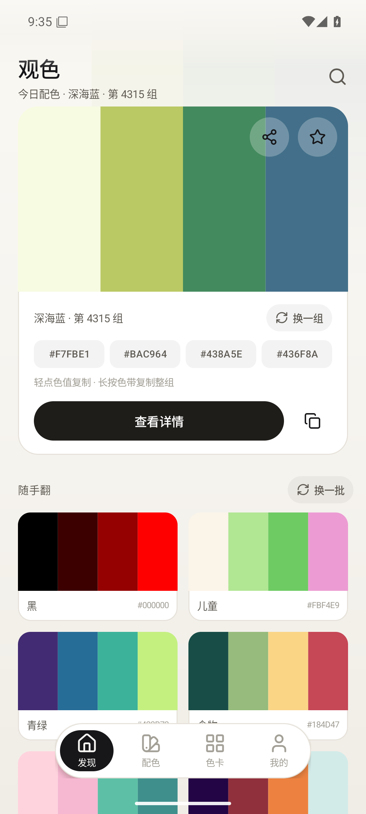
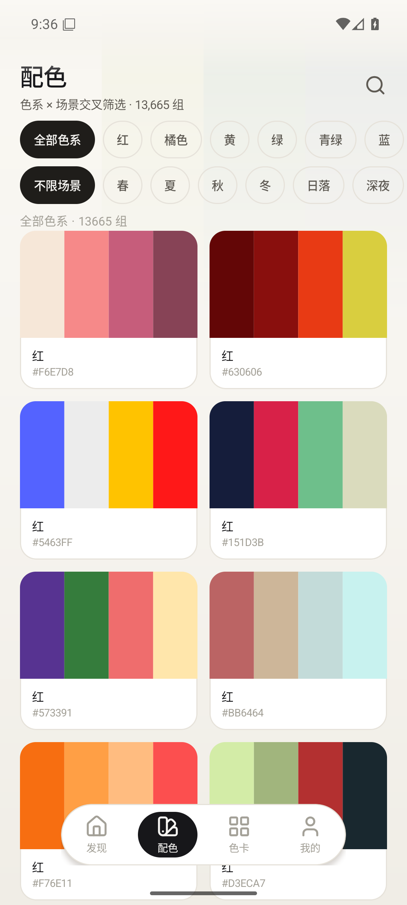
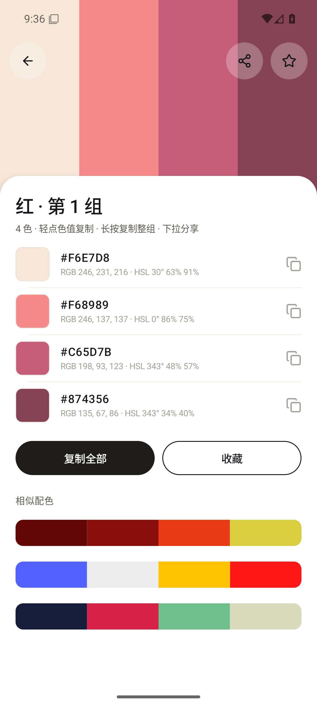
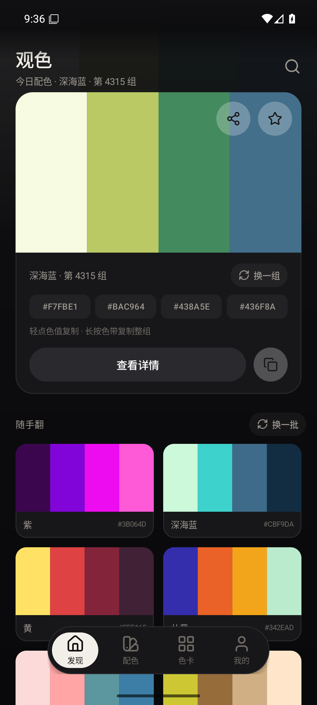
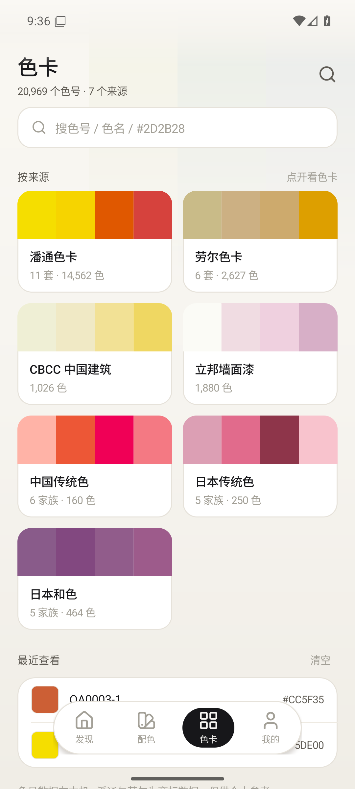
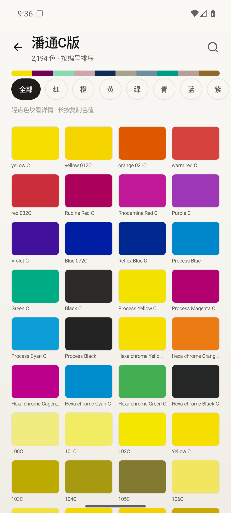
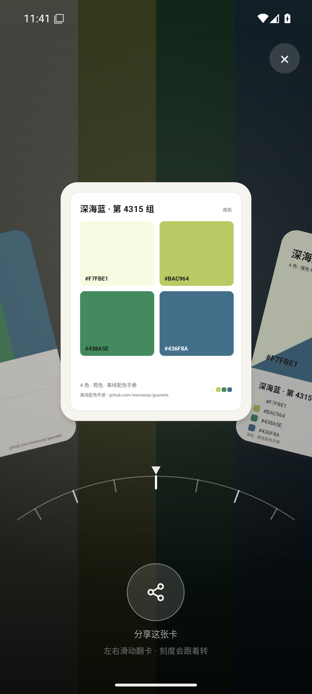
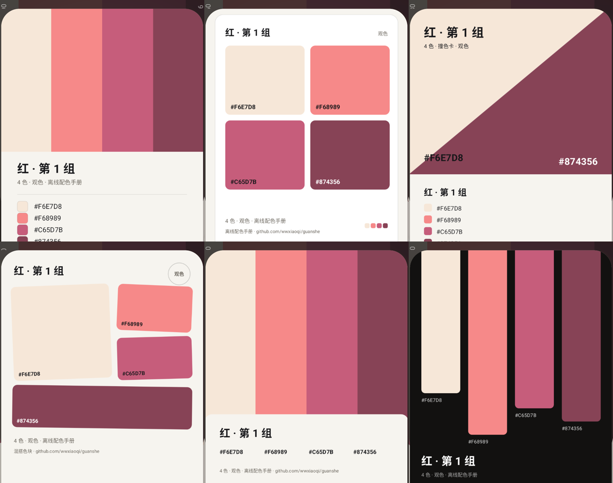

<div align="center">


<h1>观色 · Guanshe</h1>

<p><b>中文里那些好听的颜色名字，本来就该看得见。</b></p>

<p><sub>An offline color reference for Chinese traditional colors, PANTONE, RAL and more — 0.45 MB, no permissions, no network.</sub></p>

<p>
  
  
  
  
  
</p>

<p>
  
  
  
  
</p>

<sub>发现 · 配色 · 配色详情 · 夜间</sub>

</div>

---

## 这是什么

打开它，第一眼是四条颜色。

**观色**是一个离线的配色与色号手册：**20,969 个色号**，**13,665 组四色配色**，全部装在这台手机里。不联网、不注册、不申请任何权限、没有广告，安装包 **0.45 MB**。

色号来自 7 个来源：潘通、劳尔、CBCC 中国建筑、立邦墙面漆，以及中国与日本的传统色 —— 妃色、月白、藕荷、沈香，**874 个有名字的颜色**都在其中。

## 能做什么

- **找配色** —— 色系（红 / 橘 / 黄 / 绿 / 青绿 / 蓝 / 紫 / 粉）和场景（春、夏、秋、冬、日落、深夜、婚礼……）交叉筛选，看到喜欢的就收藏。
- **查色号** —— 搜 `#2D2B28`、搜「妃色」、搜「RAL 1000」、搜「012 C」，都能出结果；最近的搜索词会自动留下。
- **看一组颜色** —— 四色带下面直接给出每个颜色的 HEX / RGB / HSL，一键复制整组；长按色带也能复制。
- **看一个颜色** —— 单色详情里有 CMYK、白字与黑字的对比度（并标出 AA / AAA），还会按 CIEDE2000 算出最接近的传统色和 ΔE；每一项数值都可以点一下复制。
- **从照片取色** —— 相册里选一张图，自动抽出 4 个主色（按明度排序），可以直接收藏。
- **每天一组** —— 「今日配色」按当季与场景每天换一组，不想看今天的就按「换一组」，打开总有新东西看。
- **分享出去** —— 发现页、配色详情、单色详情都有分享入口；一组配色能从详情页下拉变成 3 种版式的卡片，挑一张直接发出去。
- **收藏与最近查看** —— 收藏的配色、收藏的颜色、看过的记录，全都只存在这台设备上；清空时可以撤销。

### 1.1 的界面改动

- **阴影收敛**：普通卡片、色票、搜索输入框一律不抬影，层次交给描边与底色差；只有底栏、回到顶部、详情页白色 sheet、提示条和弹层保留一层很轻的暖影。底栏影子从 7dp 降到 3dp，搜索框聚焦改用描边而不是变高。
- **底栏**：改成一枚居中的小胶囊（288dp 宽、62dp 高、72dp 触控区），选中项是墨色胶囊 + 白色图标，切换时胶囊滑动、图标弹一下、带轻震 —— 参考手机播放器的底栏尺寸，不再铺满整屏。
- **分享卡片**：发现页与配色详情右上角新增分享按钮；配色详情还能**从白纸任意位置往下拉** —— 浮纸跟着手指滑出屏幕，露出的底就是这组颜色本身，隐藏后整屏用这组颜色铺满并压暗；卡片飞入后悬在中间偏上，沿圆弧排开、可无限循环翻页，中间整张卡片一起轻轻呼吸、上下浮动。卡片下方是一圈很宽的**指南针刻度盘**：白色指针固定在正中不动，刻度环随卡片整体转动；只有等长刻度、没有数字和小刻度，每翻一格轻震一下；再往下是一颗大圆分享按钮，点和点卡片效果一样。共 6 种版式：海报 / 色票 / 撞色 / 拼贴 / 票根 / 暗场布带。
- **边到边**：targetSdk 提到 35，Android 15+ 默认全面屏展示；页面用 `WindowInsets` 动态补状态栏与手势条，详情页、搜索键盘、底栏都不会被系统栏压住。
- **有方向感的动效**：切 tab 时页面朝切换方向滑入、底栏的选中胶囊会滑过去；卡片按下去会缩一下、松开回弹；列表分批进场。系统打开「减少动态效果」时全部自动关掉。
- **更符合手的习惯**：可点区域不小于 48dp；再点一次当前 tab 回到顶部；详情页轻点色值复制、长按复制整组、下拉分享；空状态会给一个能按的出口；清空最近查看可以撤销。
- **触感收敛**：只在五个地方震动 —— 切底部 tab、随手翻「换一批」、下拉变成分享卡、分享卡翻过一格、点分享卡；色卡网格、筛选、复制、收藏等其余操作都保持安静。
- **详情页**：色带视差滚动、白色 sheet 压住色带，空间关系更清楚。

<p align="center">
  
  
  
  
</p>

<p align="center"><sub>色卡库 · 色卡网格 · 分享卡 · 6 种版式（海报 / 色票 / 撞色 / 拼贴 / 票根 / 暗场）</sub></p>

## 下载安装

到 [Releases](https://github.com/wwxiaoqi/guanshe/releases) 下载最新的 `1.1.0-release.apk` 装上即可，Android 6.0 及以上都支持。

第一次安装系统会提示「未知来源应用」，允许这一次就好。App 从头到尾不联网，装完就不会再产生任何流量。

## 代码结构

```
app/src/main/
├── java/com/wwxiaoqi/guanshe/
│   ├── MainActivity.java    四个 tab 的壳（页面只建一次、转场、底栏、返回手势）
│   ├── *Activity.java       配色详情 / 单色详情 / 色卡库 / 色卡网格 / 搜索 / 取色
│   ├── page/                发现、配色、色卡、我的 —— 四个 tab 的内容
│   ├── ui/                  自绘件 + 设计系统：色带、色票、涟漪、色晕、底栏、提示条、
│   │                        动效（Motion）、阴影（Surface）、触感（Haptics）
│   ├── core/                量化取色、今日配色、收藏、CIEDE2000 色差
│   ├── data/                TSV 读取、搜索、来源索引
│   └── Skin.java            颜色 / 字号 / 间距 / 圆角的唯一来源
├── assets/data/             5 个离线 TSV（772 KB）
├── res/anim/                页面转场动画
└── AndroidManifest.xml
```

**界面里没有一行 XML 布局**：仓库里连 `res/layout/` 目录都没有，每个页面都在 Java 里建 View，色带、色票、涟漪、底栏全部 `Canvas` 手绘。整包只依赖 Android 框架本身 —— 没有 androidx，没有 Kotlin，没有图片加载库，也没有网络库。

## 反馈

发现色值有误、想要某个新的色卡来源，或者觉得界面哪里别扭，都欢迎开 [Issue](https://github.com/wwxiaoqi/guanshe/issues) 或直接提 PR。这个项目没有服务器也没有账号体系，改一行代码、换一个图标、加一组颜色，都可以单独成一次提交。

## 数据与商标

- 色号数据整理自公开色卡资料与中日传统色名，**仅供学习与个人参考**。
- **PANTONE®** 与 **RAL®** 分别是潘通公司（Pantone LLC）与德国 RAL 研究所（RAL Deutsches Institut für Gütesicherung und Kennzeichnung）的注册商标与商业色卡。本项目与其没有任何关联，也不代表其官方色值；如需用于设计生产，请购买正版色卡。
- 功能图标来自 [Lucide](https://lucide.dev)（ISC 许可），转为 VectorDrawable 使用；启动图标为自制。

## 许可

[MIT](LICENSE)
